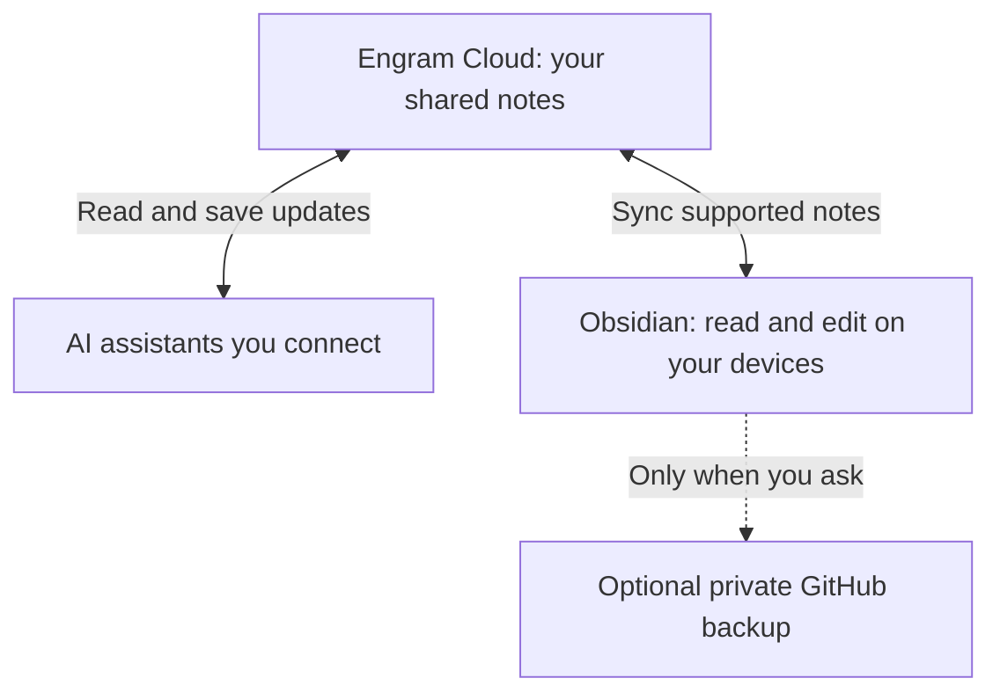

<p align="center">
  <a href="https://tyyy-z.github.io/brain-carry/">
    
  </a>
</p>

# BrainCarry

**Models change. Your context stays.**

Keep the useful things your AI assistants should know about you in one set of notes: your background, preferences, current work and next steps. A connected assistant reads those notes before helping, then saves updates when you ask.

**[See the website](https://tyyy-z.github.io/brain-carry/)** · [Download the latest source](https://github.com/tyyy-z/brain-carry/archive/refs/heads/main.zip) · [Quick start](#quick-start) · [Technical details](#technical-details)

## An everyday example

You are preparing for a job interview.

1. **On your laptop:** ask an assistant to save the role you are preparing for, your preferred feedback style and the next practice task.
2. **On your phone:** ask a connected assistant to read those notes and help you practice your introduction.
3. **Next session:** ask it to save the useful feedback and next step, so you can continue without repeating the whole introduction.

This is a fictional example of the workflow. Each assistant needs access to the same notes and must actually read them. BrainCarry does not send updates into another chat automatically.

## Where it helps

| Everyday task | Useful details to keep |
| --- | --- |
| Interview preparation | Target role, preferred feedback, practice notes and next question |
| Learning a new skill | Your goal, current lesson, sticking points and next exercise |
| A side project | Decisions, constraints, what is done and what to work on next |
| Writing with AI | Audience, writing preferences, approved drafts and open edits |

## How it works

BrainCarry is an **Agent Skill**: reusable instructions that help an AI read and maintain your notes. It includes blank note templates and local tools. You keep using your own assistants and editor.

The recommended shared setup is:



**Engram Cloud** stores the shared notes. **Obsidian** lets you read and edit them on your devices. Each supported AI assistant connects separately, with your permission.

Cloud access can work while your laptop is off. The local Obsidian folder catches up when its sync client runs. If you choose local files only, that computer must be available to read them.

You decide what to save. Connecting a tool does not save every chat or change a model's built-in memory. GitHub is optional manual backup; there is no background scheduler or automatic push.

## Quick start

### 1. Get the skill

Download the [latest source ZIP](https://github.com/tyyy-z/brain-carry/archive/refs/heads/main.zip) and extract it, or clone this repository. Copy the entire `brain-carry/` folder into a skill location supported by your assistant.

If your assistant can read local files, you can instead ask it to read [`brain-carry/SKILL.md`](brain-carry/SKILL.md) directly. Installation and automatic skill discovery vary by client.

The original [v0.1.0 release](https://github.com/tyyy-z/brain-carry/releases/tag/v0.1.0) remains available, but the latest source includes newer documentation.

### 2. Ask for help setting up

> Use $brain-carry to set up shared notes for my AI assistants with Engram Cloud and Obsidian. Keep my existing notes. Explain the plan before connecting services or uploading anything. Keep GitHub backup manual.

Your assistant should identify your existing notes, explain the connection plan and help you authorize each client. Downloading the skill does not connect accounts or upload notes.

### 3. Save something useful

> Save that I prefer short, direct feedback, and that my next task is to practice a 60-second interview introduction. Keep this in my selected private vault.

Then ask another authorized assistant to read the saved note. Check that it can read an update and save one back before relying on the connection. Repeat that check for your phone or another computer.

## What is saved where?

A **vault** is simply the folder or collection holding your notes. A **Second Brain** is the useful knowledge you maintain there.

| File or folder | Plain-language purpose |
| --- | --- |
| `AI_BRIEF.md` | A short introduction for a new assistant |
| `PROFILE.md`, `PREFERENCES.md` | Background and preferences you choose to record |
| `NOW.md` | What you are doing and what comes next |
| `raw/` | Original requests, documents or source records |
| `wiki/` and `index.md` | Organized notes and links to find them |
| `inbox/` | Suggested changes waiting for review |
| `log.md` | A short record of meaningful updates |

## Technical details

The guides below cover permissions, file formats, evidence tracking and multiple writers. You can start with the quick-start steps above and return here when needed.

- [Architecture and existing-vault integration](brain-carry/references/architecture.md)
- [Engram/Obsidian connections and read/write checks](brain-carry/references/transports.md)
- [Contribution rules and concurrent editing](brain-carry/references/contributions.md)
- [Public release checks](brain-carry/references/public-release.md)

<details>
<summary>Local-only setup and Python tools</summary>

Python 3.10+; standard library only. From this repository root, replace `/path/to/new-vault` with an absolute path. Windows users should use an absolute Windows path.

```text
python brain-carry/scripts/bootstrap_vault.py --target /path/to/new-vault --dry-run
python brain-carry/scripts/bootstrap_vault.py --target /path/to/new-vault
python brain-carry/scripts/validate_vault.py --vault /path/to/new-vault
```

The initializer refuses nonempty destinations. For an existing vault, use the additive integration procedure; it preserves existing files instead of replacing them.

</details>

<details>
<summary>Sharing, privacy and concurrent edits</summary>

Use one live notes-sync transport for a vault. Do not add independent Git pull, iCloud or another bidirectional sync process over the same files without a deliberate conflict-handling design.

Git ignore rules and cloud exclusion settings are independent. Keep credentials, employer records and private archives outside the shared scope. The public skill and your filled-in private vault are separate artifacts.

Reread a page before changing it. If another assistant may be editing the same page, save a uniquely named suggestion in `inbox/`. You or a designated editor review and merge it. CRDT text convergence does not resolve contradictory facts.

Client permissions, mobile tool support and supported file formats require their own checks. Markdown notes syncing correctly does not establish that scripts, arbitrary JSON or application settings also sync. A structural or privacy check cannot guarantee factual accuracy or detect every private detail.

</details>

<details>
<summary>Development and release commands</summary>

```text
python tests/test_braincarry.py
python brain-carry/scripts/check_release.py --root .
python brain-carry/scripts/package_release.py --root . --output .local/brain-carry.zip
```

Use repeated `--forbid-text` flags to check relevant private phrases; never pass real credentials as shell arguments. Inspect the release manifest and contents before publishing. Temporary files belong in `.local/` and stay out of Git and release archives.

Packaging creates a local archive. It does not configure a remote, publish, or upload anything. GitHub publication requires a separate explicit request.

</details>

See [contributing](CONTRIBUTING.md), [launch copy](docs/launch-copy.md) and [website maintenance](docs/website.md).

## Credits

The raw-source / maintained-wiki approach is inspired by [Andrej Karpathy's LLM Wiki note](https://gist.github.com/karpathy/442a6bf555914893e9891c11519de94f). This is an independent implementation, not an official Karpathy, Obsidian, Engram or model-provider product. Optional Engram behavior should be checked against its [official user guide](https://github.com/engram-app/Engram-obsidian/blob/main/docs/user-guide.md).

MIT licensed. v0.1.0 is the initial published release; cloud-first documentation updates on main do not constitute a new GitHub Release. Local initialization and synthetic filesystem checks were exercised on Windows; live compatibility with every assistant, mobile client or cloud setup is not implied.
